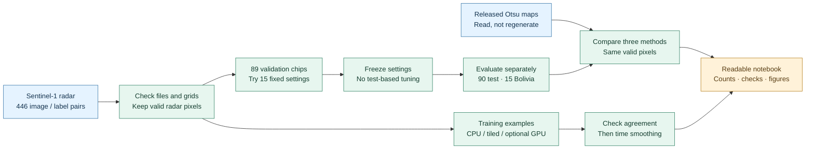

# Sen1Floods11 surface-water mapping

**A small, reproducible radar experiment.** Detect labeled surface water with a
simple threshold, check whether local averaging helps, and compare equivalent
CPU, tiled-CPU and optional GPU implementations. No machine-learning model is trained.

The labels show **water observed during flood events**, not necessarily land that
has newly flooded. This is a research/teaching workflow, not a warning system.

[Open the step-by-step notebook](notebooks/surface_water_mapping.ipynb) ·
[Read the method](docs/METHODOLOGY.md) · [Understand the inputs](manifests/README.md)

## The experiment at a glance



The unsmoothed detector thresholds the VH radar band directly. The smoothed
detector first averages **linear power**, not decibels. Validation chooses a
window width and threshold; the test labels do not choose them.

## Quick start

You need **Python 3.11**, an internet connection for the first download, and a
normal 64-bit computer. A GPU, cloud account and paid services are not required.
Allow at least **2 GB of free disk space** for the environment, data and outputs.
All commands below run from this repository's root folder.

### 1. Create a separate Python environment

Windows PowerShell, without changing the shell's execution policy:

```powershell
py -3.11 -m venv .venv
.\.venv\Scripts\python.exe -m pip install -r requirements.txt
.\.venv\Scripts\python.exe -m unittest discover -s tests -v
```

macOS or Linux:

```sh
python3.11 -m venv .venv
.venv/bin/python -m pip install -r requirements.txt
.venv/bin/python -m unittest discover -s tests -v
```

In the remaining commands, `python` means that environment's executable:
`.\.venv\Scripts\python.exe` on Windows or `.venv/bin/python` on macOS/Linux.
The small test suite uses synthetic inputs and does not download the dataset.
Optional CUDA tests skip when CUDA is unavailable.

### 2. Run the notebook from beginning to end

```sh
python scripts/execute_notebook.py
```

This starts a fresh kernel using the same Python executable. It downloads and
verifies missing inputs, selects settings on validation, evaluates the detectors,
compares released Otsu maps, and creates the figures. No kernel installation or
interactive Jupyter server is needed.

Open `runs/notebook/surface_water_mapping.executed.ipynb` in VS Code, Jupyter or
another notebook viewer. Detailed files go into a new timestamped subfolder of
`runs/notebook/`. The committed notebook intentionally has **no saved outputs**:
it stays small and cannot present stale output as a new run.

For interactive use, open the source notebook with this environment and choose
**Restart Kernel and Run All**. A graphical Jupyter frontend is optional and is
not installed by the requirements file. Set `RUN_BENCHMARK = False` in the first
code cell if you want accuracy results without timing.

### Command-line alternatives

```sh
# Full calibration and evaluation, without the optional timing stage:
python scripts/run_study.py --output runs/my-study --skip-benchmark

# Compare the released Otsu maps with the saved reference detectors:
python scripts/compare_otsu.py --output runs/my-otsu --coverage-policy intersection

# Only download and verify the 446 image/label pairs:
python scripts/download_full_data.py
```

Use a **new, empty output directory** for each command-line run. The Otsu command
uses the committed reference configuration; it does not use settings from a
previous `run_study.py` invocation. Both workflows check the same input hashes.
The notebook runs both and verifies that their fixed-detector results agree.

## Data and outputs

The first full run retrieves about **0.73 GB** of radar/label files, plus the small
released-map set, from the public Sen1Floods11 v1.1 bucket. Cached files are checked
against committed byte sizes and SHA-256 hashes. A mismatch stops the run instead
of silently replacing the expected reference. Input files stay in ignored `data/`.

Every study produces a compact bundle:

- `study.json`: settings, environment, counts, checks and any timing measurements.
- `frozen_config.json`: validation-selected settings saved before test scoring.
- `evaluation.csv`: one row per chip and detector, including confusion counts.

The notebook also saves useful PNG figures and a `released_otsu/` comparison
subfolder. The Otsu-only command writes `study.json` and `evaluation.csv`.
No reports, raw imagery, environment folders or execution outputs are tracked.
The [two small reference files](reference/README.md) are needed to verify the
released-map comparison; they are not a second experiment archive.

## What the numbers mean

- Official splits: **252 training, 89 validation, 90 test, 15 separate Bolivia**
  chips. Training supplies illustrations/timing; only validation selects settings.
- The saved reference selects **3×3 smoothing at −22 dB**. The independently
  calibrated raw-VH baseline also selects −22 dB. Rerunning checks these results.
- **Pooled IoU** combines all confusion counts. **Macro IoU** gives each chip with
  a defined IoU equal weight. Undefined scores stay missing, not 0 or 1.
- Ten test chips were inspected in the earlier pilot. Results keep full90,
  prior10 and additional80 distinct; rerunning does not create an untouched test.
- Released Otsu predictions have complete ordinary-test coverage. In Bolivia,
  64 reference-water pixels are missing; the explicit common mask excludes them
  for all three methods. Nodata is never treated as non-water.
- The Otsu comparison reads released predictions. It does not rerun Otsu or
  reproduce the paper's different empty-chip metric convention.
- Timing covers warmed **smoothing only**, not download, TIFF decoding or complete
  mapping. Tiling still holds whole chips in memory; it is not out-of-core.

See the notebook and [method details](docs/METHODOLOGY.md) for the assumptions,
metric definitions and limits. Shared events and spatial dependence prevent a
claim of reliable performance on every new flood event.

## Optional NVIDIA GPU

Install `requirements-gpu.txt` in the same environment only if you want CUDA
smoothing. A compatible NVIDIA driver and CUDA runtime/toolkit must already be
installed and discoverable; the Python file does not install them. On Windows,
activate the relevant CUDA/Conda environment before running so its DLLs are found.
If CUDA is unavailable, CPU processing still works and the benchmark reports why.
GPU timing depends on the machine and is not expected to match another run.

## Project layout and checks

- `water_mapping/`: reusable detector, data loading, evaluation and visualization.
- `scripts/`: notebook execution/building, study, download and Otsu entry points.
- `tests/`: data-free numerical, workflow and download-safety tests.
- `manifests/`: official split identities and pinned source-file metadata.
- `reference/`: fixed settings and counts/fingerprints for verification.

```sh
python -m unittest discover -s tests -v
python -m compileall -q water_mapping scripts tests
python -c "import nbformat; nbformat.validate(nbformat.read('notebooks/surface_water_mapping.ipynb', as_version=4))"
python -m pip check
```

`requirements.txt` pins direct packages and uses `requirements-lock.txt` to pin
the CPU/notebook transitive dependencies. A clean Windows Python 3.11 installation
is checked during release preparation. CI checks clean CPU installations and
synthetic tests on Windows/Linux; it does not download the full dataset or test
CUDA. Pins record a tested environment, not a promise of perpetual availability
or freedom from vulnerabilities. Review updates before running untrusted files.

`scripts/build_notebook.py` is the maintained teaching source. Run it after editing
the notebook content; it regenerates the unexecuted notebook deterministically.
Do not put credentials in notebooks or commit local output folders.

## Extending the project with coding agents

[AGENTS.md](AGENTS.md) contains project-specific instructions for AI coding agents and anyone extending this research with them. It records the scientific assumptions, evaluation rules, testing requirements and data-handling safeguards that changes should preserve. Read it before making changes or give it to your coding assistant as project context. It is contributor guidance, not a dependency needed to run the experiments.

## Attribution

Data and released maps: [Cloud to Street's Sen1Floods11](https://github.com/cloudtostreet/Sen1Floods11).
Cite Bonafilia, Tellman, Anderson and Issenberg (2020), *Sen1Floods11: a
georeferenced dataset to train and test deep learning flood algorithms for
Sentinel-1*, [CVPR Workshops](https://openaccess.thecvf.com/content_CVPRW_2020/html/w11/Bonafilia_Sen1Floods11_A_Georeferenced_Dataset_to_Train_and_Test_Deep_Learning_CVPRW_2020_paper.html).

Dataset binaries are not bundled. See [input provenance and rights](manifests/README.md).
Implementation and checking were AI-assisted; the author remains responsible
for reviewing the work and any academic use.

## License

The original code and accompanying documentation in this project are licensed
under the [MIT License](LICENSE), copyright 2026 Ilia Sokolovskiy.

This grant does **not** cover Sen1Floods11 imagery, labels, released prediction
maps or upstream split CSVs in `manifests/splits/`. Those third-party materials
retain their own rights and are not relicensed by this project. Dependencies
also retain their respective licenses. See [input provenance and data rights](manifests/README.md)
before redistributing dataset material.
